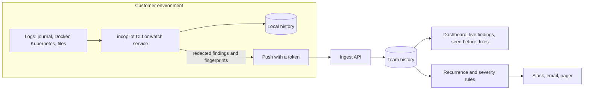

# Product plan

Status: working draft, revised 2026-11-10. The open-source CLI is real and released. The team product below is a plan that depends on the validation gate in Stage 3.

## 1. Vision

**When something breaks, an engineer should know in a minute what went wrong, in what order, and whether the team has seen it before.**

incopilot is deterministic incident triage with a memory. It reads logs where they live, explains what happened with the evidence shown, and recognizes repeat incidents along with what fixed them.

Three principles, in priority order:

1. **Correlate and explain, never auto-act.** It never changes a system.
2. **Logs stay where they are.** Analysis runs next to the logs. Only redacted findings ever leave the machine, and only when asked.
3. **Same input, same answer.** The core is rule-based, so results are reproducible and every finding points at its evidence. A model is optional and only adds a labeled hypothesis.

## 2. Who it is for

| | |
|---|---|
| **User** | Founding engineers, CTOs and first infrastructure hires |
| **Team** | 5 to 50 engineers with no dedicated SRE function |
| **Buyer** | The same person as the user. No procurement process |
| **Moment** | Something is broken, several services are logging errors, and nobody knows which one started it or whether this happened before |

## 3. Market gaps

Reviewed November 2026. Several sources are vendor-written; treat figures as indicative.

| Tool type | Examples | What it leaves open |
|---|---|---|
| Platform AI | Datadog Bits AI SRE | Works on telemetry already inside that platform |
| Incident coordination | incident.io, Rootly, PagerDuty | Workflow first; AI investigation is an add-on or sold through sales |
| Metered AI agents | Cleric | Priced per investigation; needs access to your systems |
| Open-source agents | HolmesGPT, K8sGPT, Aurora | Free, but you assemble the model, credentials and integrations, mostly on Kubernetes |
| Log platforms | Datadog, Grafana Loki, Better Stack | Storage and search are a commodity priced per GB |

The gaps this plan bets on:

1. **Trust.** In an April 2026 survey of 696 practitioners (The Register with NeuBird), 60% named lack of trust as the main barrier to AI operations tools, 59% wanted near-perfect accuracy before adopting, and 73% were not using such tools at all. A reproducible, evidence-first tool answers this directly.
2. **Memory.** Linking a new incident to an earlier one with the same cause is a paid feature of larger incident platforms. Small teams keep this in people's heads.
3. **No setup, no data handover.** Every hosted option needs your telemetry or access to your systems. Every open-source agent needs a cluster, a model and integrations.

What weakens the bet: funded vendors are moving down-market, HolmesGPT is free, and small teams may have too few repeat incidents for memory to matter. The last point is the first thing Stage 3 must test.

## 4. What we will not build

- **A log platform.** No raw log ingestion, storage or search. That market is commoditized.
- **A collection agent.** OpenTelemetry Collector, Vector and Fluent Bit already exist. "Agent" for us means the same CLI running as a service.
- **Automatic remediation.**

## 5. Stages

| Stage | What ships | Who pays | Exit criteria |
|---|---|---|---|
| 1. Memory in the CLI | Fingerprints, local history, "seen before" with fix notes. Free and open source | Nobody | Used in real incidents by people other than the maintainers |
| 2. Live and accurate | `incopilot watch` for continuous local triage, stack-trace grouping, burst detection, a labeled accuracy corpus, PyPI release | Nobody | Published accuracy; one-command install |
| 3. Validation gate | Interviews, adoption data, a paid pilot ask, a written decision | — | See section 6 |
| 4. Team memory | A small service that receives redacted findings pushed by the CLI (`--push <url>`) and gives the team one shared history: live findings, recurrence, what fixed it, by service | Teams | Three paying teams active for 30 days |
| 5. Team portal | Alerts on recurrence and severity, trends, roles, retention, optional hosted version | Teams | Decided at the end of Stage 4 |

Stages 1 and 2 are worth doing whatever Stage 3 concludes.

## 6. Validation gate

**Go** to Stage 4 only if all of these hold:

- At least 10 interviews with people who match section 2, and at least half describe finding the cause of an incident (not alert volume) as a top-three pain
- At least half of those interviewed can name an incident that repeated in the last six months
- At least 3 teams have used the CLI in a real incident and can say what it changed
- At least 2 teams commit to a paid pilot at a stated price
- The legal entity, ownership and compliance position for a commercial offer is confirmed in writing by qualified advisers

**No-go** means the CLI continues as open source and no service is built. The decision is recorded in `docs/decisions/` with the evidence.

## 7. Business model

Open core.

- **Free forever:** the CLI, local memory, all collectors, all reports.
- **Paid:** shared team memory. One history across people and services, live findings from `watch --push`, recurrence alerts, retention and roles.
- **Delivery:** self-hosted license first, because it matches principle 2 and avoids running infrastructure. Hosted later if self-hosted users ask for it.
- **Price:** set by the pilot ask in Stage 3. A flat per-team price is the starting hypothesis, since per-seat pricing punishes small teams for adding responders. No number is assumed here.

Why this can hold against larger competitors: the value compounds with a team's own history, the data is small and stays theirs, and the free tool is useful alone, which is how it gets found.

## 8. Architecture for Stages 4 and 5

- **What leaves the customer:** finding names, counts, order, target, redacted example lines and notes. Never raw logs.
- **Live view without log streaming:** `watch` analyzes short windows locally and pushes only what changed.
- **Agent, later:** the same CLI as a systemd service or Kubernetes DaemonSet.
- **Stack to start with:** Python API, PostgreSQL, the existing HTML report as the front end. Chosen for one maintainer.

## 9. Risks

| Risk | Response |
|---|---|
| Small teams have too few repeat incidents | Tested first in Stage 3; memory also spans services, which raises the hit rate |
| Funded competitors move down-market | Stay narrow and local-first; compete on trust and zero setup, not features |
| A wrong answer during a live incident ends trust | Evidence on every finding; similarity is shown as a score, never as certainty; publish accuracy |
| A leaked secret | Redaction on by default; history stores no log text |
| One maintainer | Small scope; no Stage 4 without the gate |
| Building before selling | Stage 3 exists to stop exactly this |

## 10. Stop conditions

- Stage 3 does not meet the go criteria: stop at the CLI.
- Stage 4 has fewer than three active paying teams after 90 days: stop and write up why.
- Any requirement to take automated action on production systems: decline it.
