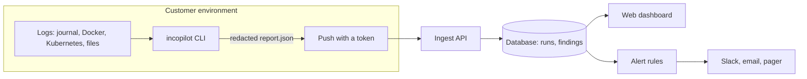

# Product plan

Status: working draft. The open-source CLI is real and released. Everything about a team product below is a plan that depends on the validation gate in Phase 3.

## 1. What incopilot is

A read-only tool that reads logs during an incident and reports what went wrong, in what order, and which safe checks to run next.

**Principle: correlate and explain, never auto-act.** This is a product feature, not a missing capability. Teams turn AI tools off after one bad call in production, so trust is built by never taking an action.

## 2. Who it is for

| | |
|---|---|
| **User** | Founding engineers, CTOs and first infrastructure hires |
| **Team** | 5 to 50 engineers with no dedicated SRE function |
| **Buyer** | The same person as the user. No procurement process |
| **Moment** | Something is broken, several services are logging errors, and nobody knows which one started it |

A broad "small and medium business" framing is not precise enough. The plan only works where the person with the problem can also decide to adopt and pay.

## 3. Landscape

As last reviewed in September 2026. Re-check before relying on it.

| Tier | Examples | Why it leaves a gap |
|---|---|---|
| Enterprise AI SRE | Resolve AI, incident.io AI SRE, NeuBird, Traversal, Datadog Bits AI SRE | Priced and built for large organizations |
| Incident coordination | Rootly, FireHydrant, Runframe | Focused on workflow, not investigation |
| Budget on-call | Spike.sh, Grafana OnCall, Better Stack | No investigation capability |
| Open source | HolmesGPT | Free, but you run and maintain the agent infrastructure yourself |

**The gap this plan bets on:** managed, low-effort investigation for teams too small to run their own agent infrastructure and too small to need an enterprise platform.

**What weakens the bet:** incident.io has added AI investigation to a lower tier, Runframe targets 10 to 200 engineers, and HolmesGPT is free. The gap is narrowing.

## 4. What is not known yet

1. Do small teams want investigation tooling, or do they only want fewer alerts?
2. Will they trust a tool with production log access at a price they can afford?
3. Is rule-based triage plus an optional model good enough to be right when it matters?

Nobody has been asked to pay. Until that happens, the team product is a hypothesis.

## 5. Phases

| Phase | Deliverable | Exit criteria |
|---|---|---|
| 0. Stabilize | v0.2 on PyPI, site live, collectors tested for real | Installable in one command; CI covers real collectors |
| 1. Sharper triage | v0.3: stack traces, bursts, per-source timelines, diff | Published accuracy on a labeled log corpus |
| 2. Share and integrate | v0.4: GitHub Action, webhook, Loki and CloudWatch | A pipeline run posts a report with no custom glue |
| 3. Validation gate | Interviews, adoption data, paid pilot ask, decision record | See section 6 |
| 4. Self-hosted alpha | v0.5: ingest API, history, dashboard | Three teams running it for 30 days |
| 5. Team portal | v1.0: alerts, trends, roles, retention | Decided at the end of Phase 4 |

Phases 0 to 2 are worth doing whatever Phase 3 concludes, because they make the open-source tool better.

## 6. Validation gate

**Go** to Phase 4 only if all of these hold:

- At least 10 interviews with people who match section 2, and at least half describe log investigation (not alert volume) as a top-three pain
- At least 3 teams have used the CLI in a real incident and can say what it changed
- At least 2 teams commit to a paid pilot at a stated price
- The legal entity, ownership and compliance position for a commercial offer is confirmed in writing by qualified advisers

**No-go** means the CLI continues as open source and no service is built. That decision is recorded in `docs/` with the evidence.

Pricing is set by the pilot ask in this phase. No price is assumed here.

## 7. Architecture for Phases 4 and 5

The CLI remains the only component that reads logs. The service never connects to customer systems.

- **Data that leaves the customer:** the redacted report only. Never raw logs.
- **Self-hosted first.** Docker Compose and Helm. A hosted version is a later decision.
- **Dashboard:** built on the existing report viewer, adding history, per-service trends and comparison.
- **Stack to start with:** Python API, PostgreSQL, the viewer as the front end. Chosen for one maintainer, not for scale.

## 8. Risks

| Risk | Response |
|---|---|
| Funded competitors move down-market | Stay narrow: investigation only, read-only, self-hosted first |
| A wrong answer during a live incident ends trust | Every finding shows its evidence; AI output is labeled unverified; publish accuracy |
| A leaked secret in a report | Redaction on by default, tests for it, and a clear statement that it is pattern-based |
| One maintainer | Keep scope small; do not start Phase 4 without the gate |
| Building before selling | Phase 3 exists to stop exactly this |

## 9. Stop conditions

- Phase 3 does not meet the go criteria: stop at the CLI.
- Phase 4 alpha has fewer than three active teams after 90 days: stop and write up why.
- At any point, a requirement to take automated action on production systems: decline it. It breaks the core principle.
